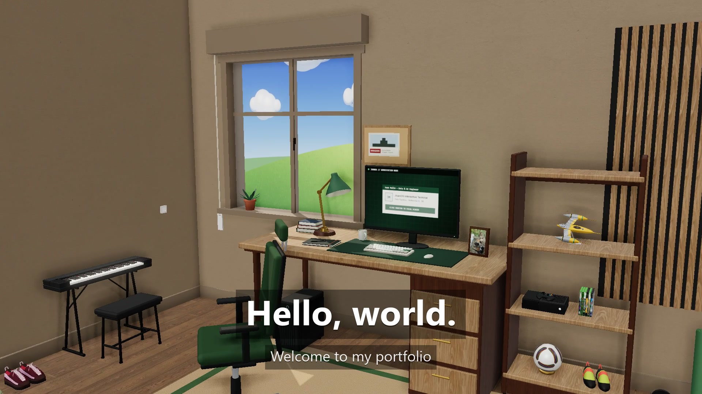

# Juan Mallo de la Calle

### AI / ML Engineer · Data Systems Engineer · Multimodal AI Researcher

Building applied AI systems with a focus on **machine learning**, **multimodal data**, **computer vision**, **generative AI**, and **reproducible data workflows**.

 

---

## About

💻 I'm a Data Systems Engineer with a completed MSc in Signal Theory and Communications, specializing in **Signal Processing and Machine Learning for Big Data** at Universidad Politécnica de Madrid.

🤖 My work combines research-oriented AI with practical engineering: multimodal dataset generation, LLM/VLM evaluation pipelines, synthetic image generation, explainable AI, computer vision, geospatial analytics and applied machine learning.

🤝 I am currently looking for opportunities in **Machine Learning Engineering**, **Data Science**, **Data Engineering**, **AI Engineering** and **Research Engineering**.

---

## Featured: JuanOS 🏠

My portfolio is a room you can explore. **JuanOS** is a 3D bedroom whose light follows your local time; sit at the desk and the computer boots a small OS about me: my research (DREAM), a demo of my travel gallery, a chess game against three versions of me and a terminal that hides a secret. 14 achievements, plus one hidden.

Built with TypeScript, React, Vite and Three.js, with Claude Code as a development partner.

**👉 [juanos.pages.dev](https://juanos.pages.dev)**

---

## Technical Toolbox

### Languages & Data

### Machine Learning & AI

### Data Science & Engineering

### Web & 3D

---

## Research & Portfolio

- First-author paper published in the **Proceedings of LREC 2026** on multimodal, persona-grounded dialogue data and AI-generated visual summaries.
- Research experience building multimodal AI pipelines with LLMs, VLMs and text-to-image APIs.
- Portfolio repositories focused on applied AI, explainability, computer vision, urban mobility analytics and reinforcement learning.
- An interactive portfolio, [JuanOS](https://juanos.pages.dev), that brings it all together in a 3D room.

Explore my pinned repositories below for selected projects.

---

## Education

**MSc in Signal Theory and Communications**  
Signal Processing and Machine Learning for Big Data · Universidad Politécnica de Madrid

**BSc in Data Engineering and Systems**  
Universidad Politécnica de Madrid

**Erasmus Exchange**  
Warsaw University of Technology

---

## A bit beyond work

♟️ Coding, creating and sometimes playing chess

### Open to AI / ML / Data opportunities - and always building something.

Machine Learning · Data Science · Data Engineering · Generative AI · Research Engineering

